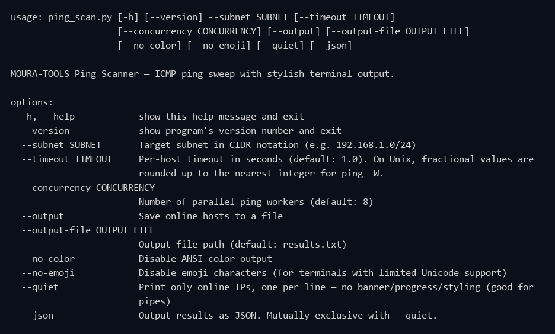
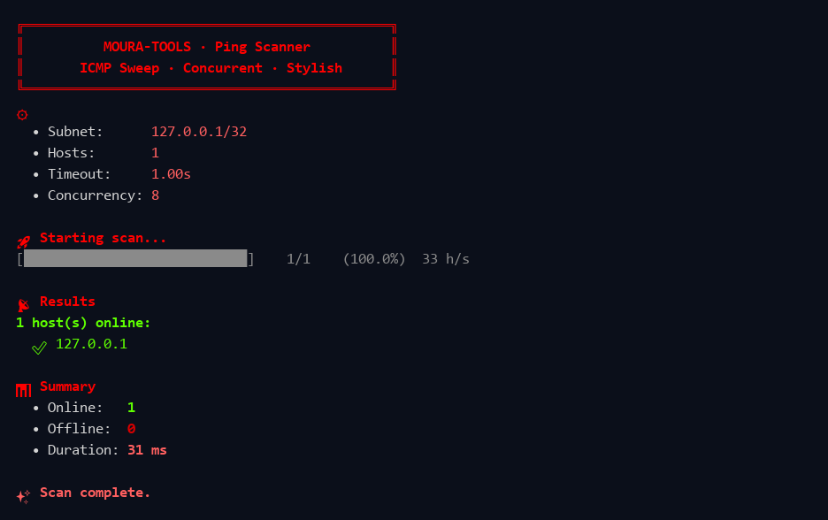
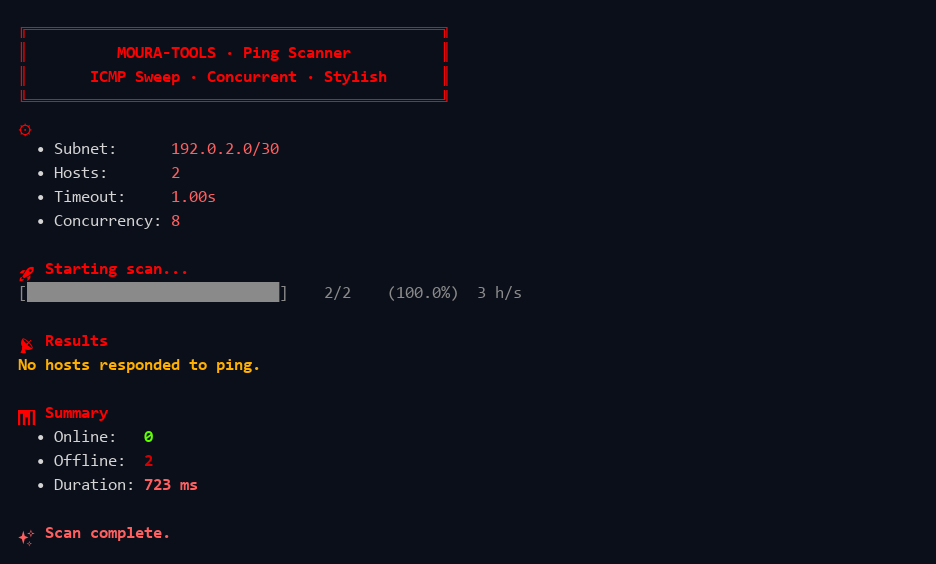
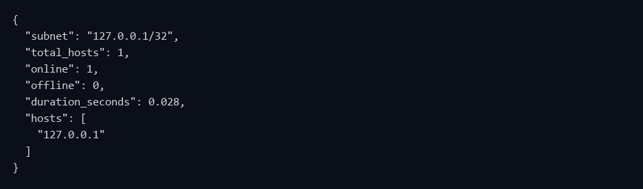
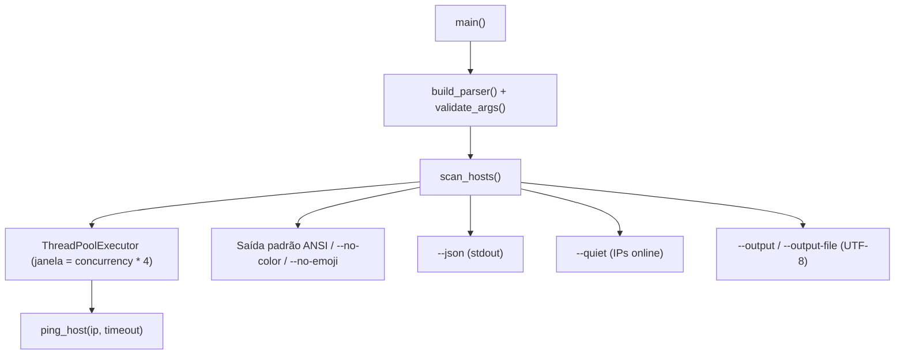

<div align="center">

# MOURA-TOOLS Ping Scanner

**Scanner CLI de varredura ICMP (*ping sweep*) concorrente em arquivo único, feito com Python puro e zero dependências externas.**

*Single-file concurrent ICMP ping sweep CLI built with pure Python and zero external dependencies.*


[Português](#-português) · [English](#-english)

</div>

---

## 🎬 Demo

<div align="center">


</div>

<details>
<summary>Ver os frames individuais / View individual frames</summary>

| `--version` | `--quiet` |
|---|---|
|  |  |

**Ajuda completa (`--help`):**



**Varredura real em `127.0.0.1/32` (host online detectado, com resumo):**



**Faixa de laboratório `192.0.2.0/30` (nenhum host respondeu):**



**Saída machine-readable (`--json`):**



</details>

> 🎥 Gravações reais da execução de `python ping_scan.py`: banner, barra de progresso em streaming, resumo (online/offline/duração) e saída `--json`.
> Transcrição em texto das execuções: [`docs/demo-transcript.txt`](docs/demo-transcript.txt).

> 🎥 Real recordings of `python ping_scan.py`: banner, streaming progress bar, summary (online/offline/duration) and `--json` output.
> Plain-text transcript of the runs: [`docs/demo-transcript.txt`](docs/demo-transcript.txt).

---

## 🇧🇷 Português

### Instalação em 3 comandos

Requer **Python 3.8+** e o utilitário `ping` do sistema (sem `pip install`).

```bash
git clone https://github.com/jotape2709/moura-ping-scanner.git
cd moura-ping-scanner
python ping_scan.py -h
```

### Recursos confirmados

- **Zero dependências externas**: arquivo único `ping_scan.py` usando apenas a biblioteca padrão do Python (`argparse`, `concurrent.futures`, `ipaddress`, `json`, `subprocess`, `sys`, `time`).
- **Varredura ICMP concorrente em streaming**: usa `ThreadPoolExecutor` com janela deslizante de *futures* (`window_size = concurrency * 4`), evitando alocar grandes listas de hosts em memória.
- **Saída estruturada (`--json`)**: gera JSON limpo no `stdout` com `subnet`, `total_hosts`, `online`, `offline`, `duration_seconds` e `hosts`.
- **Modo silencioso (`--quiet`)**: imprime apenas os IPs online (um por linha), pronto para pipes e automação.
- **Exportação em arquivo (`--output` / `--output-file`)**: salva os IPs online em arquivo UTF-8.
- **Controle visual (`--no-color`, `--no-emoji`)**: desativa cores ANSI e caracteres Unicode para terminais simples.
- **Validação de entrada**: rejeita subnets inválidas, `--timeout` ou `--concurrency` `<= 0` e uso simultâneo de `--quiet` com `--json` (saída com código `1` e mensagem clara).
- **Informações da CLI**: suporte a `-h` (ajuda) e `--version` (`MOURA-TOOLS Ping Scanner v2.0.0`).

### Exemplos de uso

**1. Varredura básica e ajuste de timeout/concorrência:**

```bash
python ping_scan.py --subnet 127.0.0.1/32
python ping_scan.py --subnet 192.0.2.0/30 --timeout 0.5 --concurrency 20
```

**2. Saída em JSON (`--json`) e modo silencioso (`--quiet`):**

```bash
python ping_scan.py --subnet 127.0.0.1/32 --json
python ping_scan.py --subnet 127.0.0.1/32 --quiet
```

Exemplo de estrutura JSON retornada:

```json
{
  "subnet": "127.0.0.1/32",
  "total_hosts": 1,
  "online": 1,
  "offline": 0,
  "duration_seconds": 0.045,
  "hosts": [
    "127.0.0.1"
  ]
}
```

**3. Exportação para arquivo e terminal sem ANSI/emojis:**

```bash
python ping_scan.py --subnet 127.0.0.1/32 --output --output-file hosts_online.txt
python ping_scan.py --subnet 127.0.0.1/32 --no-color --no-emoji
```

### Arquitetura



### Roadmap

- [ ] Validar execução e comportamento de rede nativo em **Linux** e **macOS** (auditoria atual confirmada em Windows 11).

### Licença

Distribuído sob a licença **MIT**. Consulte o arquivo [LICENSE](LICENSE).

---

## 🇺🇸 English

### 3-Command Setup

Requires **Python 3.8+** and the system `ping` utility (no `pip install` needed).

```bash
git clone https://github.com/jotape2709/moura-ping-scanner.git
cd moura-ping-scanner
python ping_scan.py -h
```

### Confirmed Features

- **Zero external dependencies**: single file `ping_scan.py` built strictly with the Python standard library (`argparse`, `concurrent.futures`, `ipaddress`, `json`, `subprocess`, `sys`, `time`).
- **Streaming concurrent ICMP sweep**: uses `ThreadPoolExecutor` with a bounded sliding futures window (`window_size = concurrency * 4`) to avoid excessive memory usage on large subnets.
- **Structured JSON output (`--json`)**: writes clean JSON to `stdout` containing `subnet`, `total_hosts`, `online`, `offline`, `duration_seconds`, and `hosts`.
- **Quiet mode (`--quiet`)**: prints only reachable IP addresses (one per line) for pipes and scripts.
- **File export (`--output` / `--output-file`)**: writes online IPs to a UTF-8 text file.
- **Display controls (`--no-color`, `--no-emoji`)**: disables ANSI colors and Unicode icons for plain terminals.
- **Input validation**: rejects invalid CIDR subnets, `--timeout` or `--concurrency` `<= 0`, and mutually exclusive `--quiet` + `--json` flags, exiting with code `1` and a clear message.
- **CLI metadata**: supports `-h` (help) and `--version` (`MOURA-TOOLS Ping Scanner v2.0.0`).

### Usage Examples

**1. Basic sweep and custom timeout/concurrency:**

```bash
python ping_scan.py --subnet 127.0.0.1/32
python ping_scan.py --subnet 192.0.2.0/30 --timeout 0.5 --concurrency 20
```

**2. JSON output (`--json`) and quiet mode (`--quiet`):**

```bash
python ping_scan.py --subnet 127.0.0.1/32 --json
python ping_scan.py --subnet 127.0.0.1/32 --quiet
```

Example JSON output structure:

```json
{
  "subnet": "127.0.0.1/32",
  "total_hosts": 1,
  "online": 1,
  "offline": 0,
  "duration_seconds": 0.045,
  "hosts": [
    "127.0.0.1"
  ]
}
```

**3. Save to file and disable ANSI/emojis:**

```bash
python ping_scan.py --subnet 127.0.0.1/32 --output --output-file online_hosts.txt
python ping_scan.py --subnet 127.0.0.1/32 --no-color --no-emoji
```

### Architecture


### Roadmap

- [ ] Validate execution and native networking behavior on **Linux** and **macOS** (current audit confirmed on Windows 11).

### License

Distributed under the **MIT** License. See [LICENSE](LICENSE) for details.
